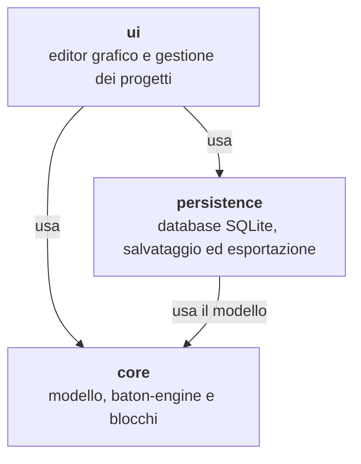
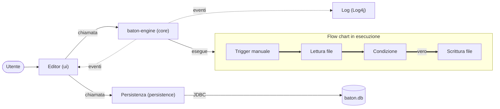
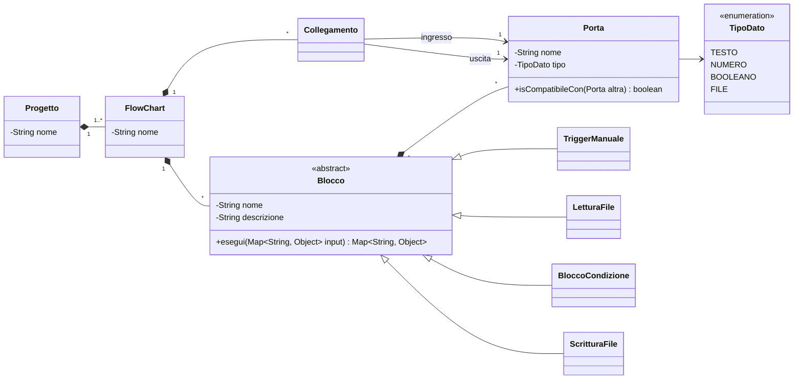

# Design

Questo documento descrive il design di `Baton` e raccoglie tre contenuti: la modellazione UML (sezione 1), l'architettura software (sezione 2) e il design di dettaglio con i design pattern adottati (sezione 3). Si basa sui requisiti definiti nell'[SRS](03_srs.md) e sull'organizzazione del codice descritta nel documento di [Project Management](02_project_management.md) (sezione 2.2).

## 1. Modelling

I diagrammi UML sono realizzati con StarUML 5. Il file di progetto StarUML si trova in `docs/uml/baton.mdj`, mentre le immagini esportate si trovano nella cartella `docs/uml/img/`. Lo use case diagram è riportato nell'SRS (sezione 3.5); gli altri diagrammi sono collegati alle sezioni di questo documento come indicato in tabella.

| Diagramma | Contenuto | Sezione |
| :--- | :--- | :--- |
| Package diagram | Package `core`, `ui`, `persistence` e loro dipendenze | 2.2.1 |
| Component diagram | Componenti e connettori del sistema in esecuzione | 2.2.2 |
| Class diagram | Modello del dominio, da cui StarUML genera lo scheletro Java (Project Management, sezione 1.3) | 3.1 |
| State machine diagram | Stati di un'esecuzione del flow chart: validazione, esecuzione dei blocchi, attesa (blocco ritardo), completamento, errore e interruzione | 3.1 |
| Sequence diagram | Esecuzione di un flow chart dal trigger manuale fino alla notifica dell'esito alla UI, compreso il caso di blocco in errore | 3.2 |
| Activity diagram | Algoritmo del `baton-engine`: scelta del blocco successivo, valutazione del blocco condizione, gestione degli errori | 2.1 |
| Communication diagram | Salvataggio e caricamento di un progetto tra `ui`, `persistence` e database | 2.2.2 |

<!-- da completare: inserire le immagini esportate da StarUML man mano che i diagrammi vengono realizzati -->

## 2. Software Architecture

### 2.1 Stile architetturale

L'architettura di Baton combina due degli stili architetturali descritti nel libro di testo (van Vliet, sezione 11.4): uno **stile a strati** per la struttura generale dell'applicazione e uno stile **pipes and filters** per il `baton-engine`.

**Stile a strati.** I tre package del progetto corrispondono a tre livelli. Il `core` è il livello più interno e non dipende da nessun altro package; `persistence` usa il modello del `core` per salvare e caricare i progetti; `ui` usa sia `persistence` sia `core`. Si tratta di una variante a visibilità rilassata, perché la UI accede direttamente anche al `core` e non solo al livello immediatamente sottostante. Le dipendenze vanno sempre dall'esterno verso l'interno, quindi **non ci sono cicli tra i package**. In più il `core` può essere testato con JUnit senza interfaccia grafica e senza database.

**Pipes and filters.** Un flow chart di Baton è per sua natura una sequenza di elaborazioni indipendenti sui dati: ogni blocco riceve dei dati in ingresso, li elabora e produce un risultato per il blocco successivo.

| Elemento dello stile | In Baton |
| :--- | :--- |
| Componenti (filtri) | I blocchi, che elaborano i dati ricevuti sulle porte di ingresso e producono un risultato sulle porte di uscita |
| Connettori (pipe) | I collegamenti, che portano l'output di un blocco in ingresso al blocco successivo |
| Struttura di controllo | Il `baton-engine` esegue un blocco alla volta seguendo i collegamenti a partire dal trigger (RF-06) |
| Variante | Batch sequenziale: ogni blocco termina prima che parta il successivo, coerentemente con l'esclusione dell'esecuzione parallela (Won't Have). Le diramazioni sono possibili solo tramite il blocco condizione |

Il libro evidenzia due criticità di questo stile, che in Baton vengono affrontate così:

* **Formato dei dati tra filtri adiacenti:** due filtri collegati devono concordare la struttura dei dati che si scambiano. In Baton ogni porta ha un tipo di dato e un collegamento viene accettato solo se le porte sono compatibili (RF-02).
* **Gestione degli errori**, definita dal libro il "tallone d'Achille" dello stile: è difficile propagare un errore attraverso i filtri intermedi. In Baton l'errore non attraversa la catena di blocchi, ma viene intercettato direttamente dal `baton-engine`, che interrompe l'automazione e mostra quale blocco ha fallito e perché, senza far crashare l'applicazione (RF-06, RNF-02).

### 2.2 Viste architetturali

Il libro suddivide i punti di vista in tre classi (moduli, componenti e connettori, allocazione) e osserva che di solito ne basta uno per classe. Per Baton è riportata una vista per ciascuna classe.

#### 2.2.1 Vista dei moduli (decomposizione e strati)

| Package | Contenuto | Usa |
| :--- | :--- | :--- |
| `it.unibg.baton.core` | `core.model`: progetto, flow chart, blocco, porta e collegamento. `core.engine`: `baton-engine` e validazione dei collegamenti. `core.blocks`: blocchi concreti (RF-07, RF-08) | Solo librerie Java e Log4j |
| `it.unibg.baton.persistence` | Connessione al database SQLite, operazioni CRUD su progetti e flow chart (RF-03, RF-05), esportazione e caricamento (RF-09) | `core` |
| `it.unibg.baton.ui` | Finestre dell'applicazione, editor dei flow chart (RF-04), configurazione dei parametri dei blocchi, avvio dell'applicazione | `core`, `persistence` |

Se in futuro i package verranno separati in moduli Maven (`baton-core`, `baton-persistence`, `baton-ui`, come previsto nel Project Management), le dipendenze resteranno le stesse. Maven inoltre rifiuta le dipendenze cicliche tra moduli, quindi l'assenza di cicli verrebbe verificata già in fase di build.

<!-- da completare: package diagram StarUML (docs/uml/img/package_diagram.png) -->

#### 2.2.2 Vista componenti e connettori

La vista mostra il sistema durante l'esecuzione di un flow chart di esempio. Le frecce piene sono chiamate di procedura, quelle spesse il flusso di dati tra i blocchi e quelle tratteggiate le notifiche di eventi.

I connettori, classificati secondo la Tabella 11.7 del libro, sono:

| Tipo di connettore | Tra | Uso |
| :--- | :--- | :--- |
| Chiamata di procedura | `ui` → `baton-engine`, `ui` → `persistence` → database (JDBC) | Avvio di un'esecuzione, salvataggio e caricamento dei progetti |
| Flusso di dati | Blocco → blocco, gestito dal `baton-engine` | L'output di un blocco diventa il parametro di ingresso del blocco collegato |
| Invocazione implicita | `baton-engine` → editor e log | Notifica di blocco avviato, completato o fallito, con il pattern Observer (sezione 3.2.2) |

Il `baton-engine` viene eseguito su un thread separato da quello dell'interfaccia grafica: in questo modo un blocco lento, come un ritardo o una richiesta HTTP, non blocca la finestra. Le notifiche ricevute dall'editor vengono riportate sul thread della UI prima di aggiornare la grafica.

<!-- da completare: component diagram StarUML (docs/uml/img/component_diagram.png) -->

#### 2.2.3 Vista di allocazione (incarico di lavoro e distribuzione)

**Incarico di lavoro.** Ogni package ha un responsabile, come stabilito nel Project Management (sezione 2.2):

| Area | Responsabile |
| :--- | :--- |
| `core` (`baton-engine`, modello dei blocchi, porte e collegamenti) | Nicolò Spampatti |
| `core.blocks` (blocchi concreti) | Marco Magri |
| `persistence` | Matteo Piffari |
| `ui` | Giovanni Ghilardi |

**Distribuzione.** Baton viene eseguito su un unico computer (Windows, macOS o Debian) con Java 21 installato, all'interno di una sola JVM. Il database è un file SQLite salvato nella cartella dell'utente (`~/.baton/baton.db`): il percorso viene calcolato a runtime a partire dalla proprietà `user.home`, quindi nel codice non compaiono percorsi assoluti. La connessione a internet serve solo ai blocchi che contattano servizi esterni (RF-08, RF-12).

### 2.3 Decisioni architetturali

Le decisioni principali sono riportate in forma sintetica rispetto al modello della Tabella 11.1 del libro. Le modifiche future verranno discusse tramite Issue o Pull Request, come previsto dal Project Plan (sezione 13).

| Decisione | Alternative scartate | Motivazione |
| :--- | :--- | :--- |
| Applicazione desktop all-in-one | Client-server REST con Spring Boot, web app | Baton non deve dipendere da server esterni (SRS, sezione 2.1) e deve funzionare offline |
| Tre package a strati, senza cicli | Package unico, moduli Maven separati fin dall'inizio | Separazione delle responsabilità e lavoro in parallelo con una struttura semplice; i moduli restano un'opzione |
| `baton-engine` pipes and filters sequenziale | Ogni blocco chiama direttamente il successivo | I blocchi non si conoscono tra loro e gli errori vengono gestiti in un solo punto |
| Database embedded SQLite via JDBC | File JSON, Firebase | Vincolo di progetto (database embedded), operazioni CRUD sui flow chart, nessuna installazione richiesta |
| JavaFX come libreria UI (proposta) | Swing | Grafica, CSS e animazioni già disponibili per l'editor (RF-04), lo sfondo blueprint (RF-11) e il testimone (RF-13). Da confermare con il prototipo dell'editor in TB1 (Project Plan, sezione 6) |

### 2.4 Librerie esterne

Le dipendenze sono gestite con Maven e dichiarate nel `pom.xml`, insieme alle relative versioni.

| Libreria | Uso |
| :--- | :--- |
| `org.xerial:sqlite-jdbc` | Driver JDBC per il database embedded SQLite |
| `org.apache.logging.log4j:log4j-core` | Logging delle esecuzioni e degli errori dei blocchi, su console e su file |
| `org.openjfx:javafx-controls`, `javafx-fxml` | Interfaccia grafica (se la proposta viene confermata) |
| `org.junit.jupiter:junit-jupiter` | Test di unità |

## 3. Software Design

### 3.1 Modello del dominio

Il modello segue il glossario dell'SRS (sezione 1.3). Un progetto contiene uno o più flow chart; ogni flow chart è composto da blocchi e collegamenti; ogni blocco ha porte di ingresso e di uscita con un tipo di dato. Un collegamento unisce sempre una porta di uscita a una porta di ingresso compatibile. I parametri non collegati a un altro blocco contengono un valore costante inserito dall'utente.

Il diagramma è una prima versione da allineare con il class diagram StarUML, dal quale verrà generato lo scheletro del codice. I blocchi concreti estendono la classe astratta `Blocco` e ridefiniscono il metodo `esegui` (`@Override`); per semplicità nel diagramma ne sono riportati solo quattro.

<!-- da completare: class diagram e state machine diagram StarUML (docs/uml/img/) -->

### 3.2 Design pattern

I pattern adottati sono tra quelli visti a lezione (Lethbridge e Laganière, capitolo 6) e sono descritti con lo schema contesto, problema e soluzione. Seguendo l'indicazione del corso di non abusare dei pattern, ne sono stati applicati solo tre, nei punti in cui emergono direttamente dai requisiti.

#### 3.2.1 Factory (creazione dei blocchi)

* **Contesto:** il `baton-engine` e l'editor funzionano come un framework che deve creare blocchi di cui non conosce in anticipo la classe concreta. I blocchi aumenteranno nel tempo (RF-07, RF-08, RF-12).
* **Problema:** come aggiungere un nuovo tipo di blocco senza modificare il `core` (RNF-03)?
* **Soluzione:** il `core` definisce l'interfaccia `BloccoFactory`, con un metodo `crea(String tipo)` che restituisce un `Blocco`. L'implementazione `RegistroBlocchi` associa a ogni tipo il costruttore del blocco concreto (una `Map<String, Supplier<Blocco>>` con riferimenti come `LetturaFile::new`). L'editor usa la factory per popolare l'elenco dei blocchi disponibili, mentre `persistence`, quando carica un flow chart dal database, legge il tipo salvato e chiede alla factory di ricreare il blocco corretto. Aggiungere un blocco significa quindi scrivere una nuova classe e registrarla, senza toccare il motore.

#### 3.2.2 Observer (notifiche di esecuzione)

* **Contesto:** durante un'esecuzione la UI deve sapere quale blocco è in corso (testimone, RF-13) e quale blocco è fallito e perché (RF-02, RF-06).
* **Problema:** se il `baton-engine` chiamasse direttamente l'editor, il `core` dipenderebbe dalla `ui`, creando un ciclo tra i package e rendendo il motore non testabile senza interfaccia.
* **Soluzione:** il `core` definisce l'interfaccia `EsecuzioneListener` (l'osservatore), con i metodi `bloccoAvviato`, `bloccoCompletato`, `bloccoFallito` ed `esecuzioneTerminata`. Il `baton-engine` (l'osservabile) mantiene una lista di listener e li notifica a ogni passo. Editor e logger si registrano come listener. In questo modo si evita l'antipattern in cui osservatore e osservabile si conoscono a vicenda. Si usa un'interfaccia propria perché `java.util.Observable` è deprecata da Java 9.

#### 3.2.3 Singleton (connessione al database)

* **Contesto:** tutte le classi di `persistence` che leggono e scrivono progetti e flow chart devono accedere allo stesso file `baton.db`.
* **Problema:** come garantire che esista un solo punto di accesso al database, raggiungibile da tutte queste classi?
* **Soluzione:** la classe `DatabaseManager` ha un costruttore privato e un metodo statico `getInstance()` che restituisce sempre la stessa istanza. Al primo accesso apre la connessione e crea le tabelle se non esistono. Siccome il Singleton rende più difficili i test, il percorso del database può essere impostato prima del primo utilizzo: i test JUnit usano un database temporaneo, senza toccare quello dell'utente.

### 3.3 Metriche e complessità

Quando il codice sarà disponibile verranno riportate alcune misurazioni con gli strumenti visti a lezione (ad esempio JDepend per l'accoppiamento e l'assenza di cicli tra package, SonarLint o PMD per la qualità del codice) e il calcolo della complessità ciclomatica di McCabe su un metodo del `baton-engine`.

<!-- da completare -->
